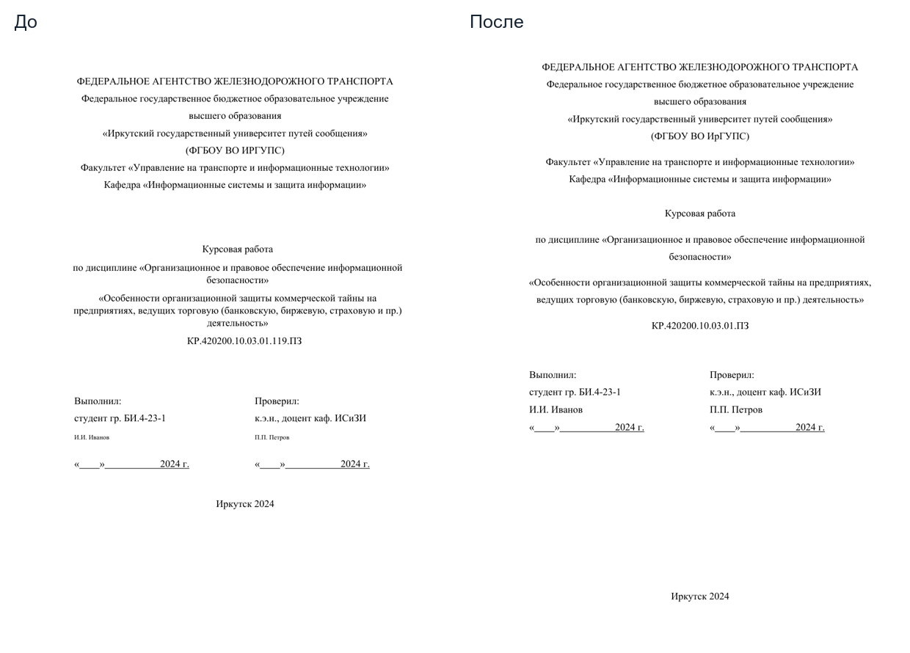
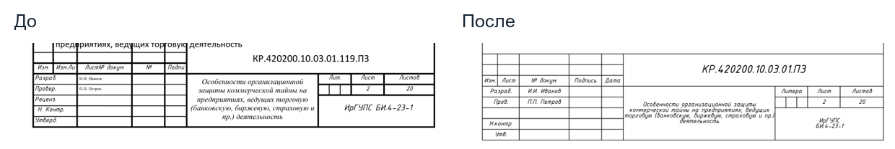
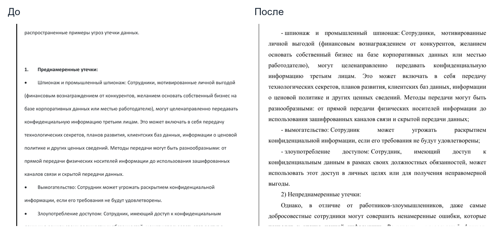
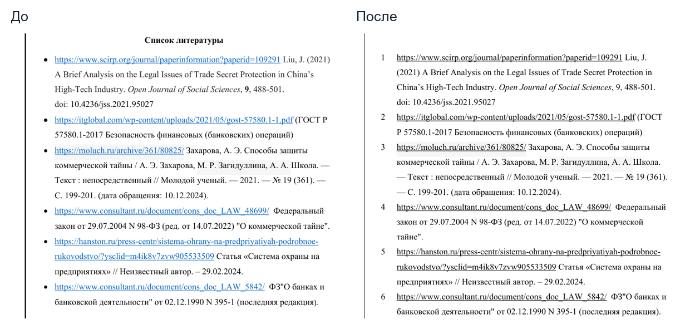
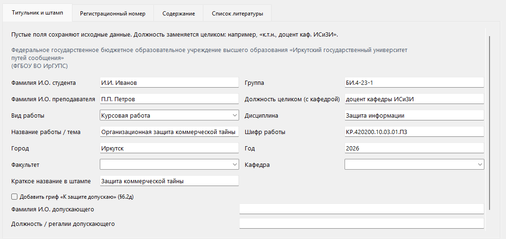
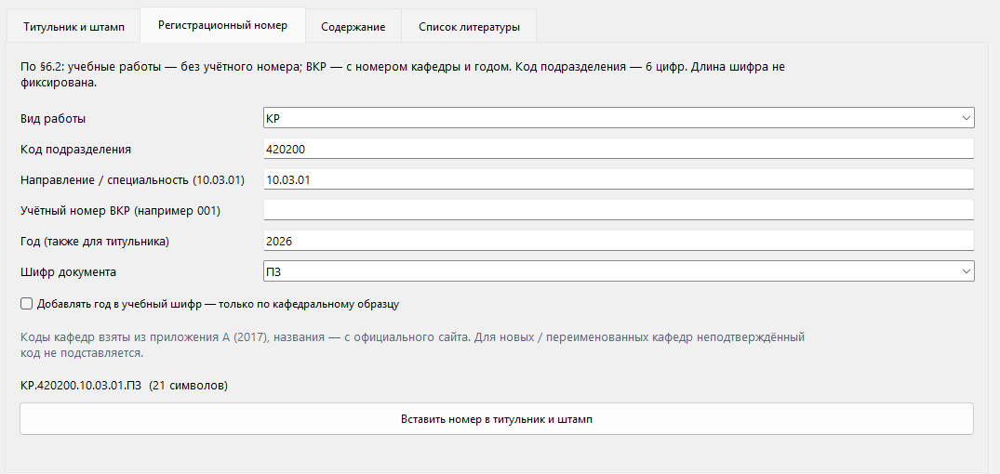
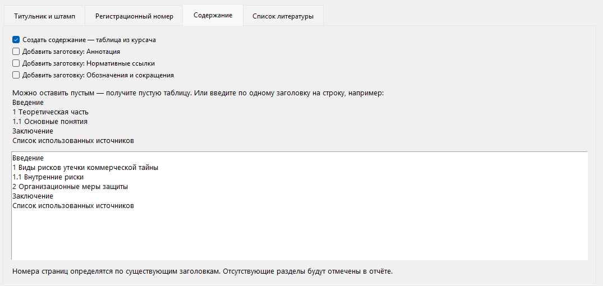
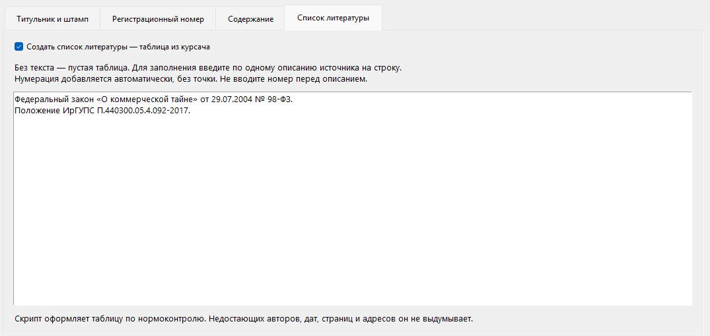

<div align="center">

# 📐 Нормоконтроль ИрГУПС

**Оформление курсовых, отчётов и дипломов: рамки, штампы и проверка результата.**

Выберите `.docx` → заполните реквизиты → получите оформленную копию, PDF и отчёт.


**[Скачать установщик EXE](https://github.com/k0zt3r/wordcraft-normokontrol/releases/latest/download/Normokontrol-1.5.0-windows-x64-setup.exe)** · **[Все выпуски](https://github.com/k0zt3r/wordcraft-normokontrol/releases)**

Версия **1.5.0** · [Что изменилось](references/changelog.md)

</div>

Ссылка на EXE станет доступна после публикации выпуска 1.5.0. До этого установщик
можно собрать из исходников по [инструкции](installer/README.md).

Программа помогает оформить титульник, содержание и источники, собрать шифр работы
и проверить вёрстку по **положению ИрГУПС П.440300.05.4.092-2017**. Можно обработать
готовый документ или создать заготовку. Исходник не перезаписывается.

## До и после

Слева — исходное оформление, справа — результат одной курсовой через Wordcraft.
Имена заменены демонстрационными. Скриншоты сделаны в предыдущей версии:
сейчас в штампах по умолчанию **Times New Roman**, 9 пт для надписей и 16 пт для шифра.
Примеры показывают отдельные изменения и не подтверждают отсутствие всех замечаний.

**Титульный лист.** Упорядочены интервалы, город и год размещены внизу страницы.



**Рамка и большой штамп.** Исправлена компоновка по приложению И, учебный шифр
приведён к виду `КР.420200.10.03.01.ПЗ`. Большой штамп размещён на второй странице.



<details>
<summary>Ещё примеры: перечисления и список источников</summary>

### Перечисления



Приведены к профилю шрифт и интервалы, изменены маркеры и завершающие знаки распознанных пунктов. Известные нарицательные начала приведены к строчной букве. Из-за новой вёрстки фрагмент расположен на другой странице; неоднозначные пункты остаются в отчёте для ручной проверки.

### Список использованных источников



Маркеры заменены нумерацией, оформление приведено к таблице без видимых границ. Программа не дописывает отсутствующие библиографические сведения и не проверяет достоверность источников.

В режиме оформления явные дефисные и автоматические списки получают завершающие знаки по фактическим уровням Word, даже если пункт содержит несколько предложений. Вводные пункты сохраняют двоеточие. Известные нарицательные начала («шифрование», «вымогательство», «основы» и другие из словаря) начинаются со строчной буквы; неизвестные имена и аббревиатуры автоматически не меняются. Изменения перечисляются в отчёте. Внутренние предложения сохраняются, спорная вложенность не перестраивается. Автоматические списки выравниваются по ширине как основной текст; центрирование списков не требуется положением.

Если внутри одного списка вводный пункт заканчивается двоеточием, а следующие пункты имеют тот же уровень, отчёт показывает конкретное место в разделе «Ручная проверка». Это возможная потеря вложенности, а не доказанная ошибка: программа не перестраивает иерархию по догадке. Распознавание не восстанавливает смысловую вложенность между разными списками Word. Неоднозначные начальные прописные буквы остаются на ручной проверке. В режиме «Только проверить» пунктуация и регистр не меняются.

</details>

## Установка

Нужна **Windows 10/11 x64**. Отдельные Python, Wordcraft, Git, Microsoft Word
и подписка на ИИ для обычной установки не требуются.

1. Скачайте EXE по ссылке выше и запустите его.
2. Выберите папку программы и ярлыки. Права администратора не нужны.
3. Установщик поставит собственные Python, Tcl/Tk и библиотеки. Совместимый
   Wordcraft будет найден; если его нет, установщик скачает официальную
   portable-копию и проверит SHA-256. Для скачивания нужен интернет.
4. После проверки компонентов запустите **Нормоконтроль ИрГУПС** из меню «Пуск».

Times New Roman используется и для основного текста, и для штампов. ISOCPEUR
для базовой установки не нужен. Установленные системные Python и Wordcraft
не изменяются. Проверка установки сохраняется в `install-report.json`.

## Как обработать работу

1. Нажмите **Выбрать…** и укажите `.docx` или **Новый документ** для заготовки.
2. Оставьте обычное оформление либо включите **Только проверить**, чтобы получить
   замечания без автоматических исправлений.
3. Заполните известные реквизиты на вкладке **Титульник и штамп**. Пустые поля
   сохраняют исходные значения. Шифр можно собрать на вкладке **Регистрационный номер**.
4. При необходимости добавьте заготовки **Содержания** и **Списка литературы**.
   Программа не пишет главы и не придумывает библиографические сведения.
5. Нажмите **Выполнить нормоконтроль** и изучите открывшийся отчёт.

Для готовой работы папка результата появляется **рядом с исходным документом**.
Для новой заготовки программа попросит выбрать место сохранения.

| Результат | Что открыть |
|---|---|
| `…_нк.docx` | Редактируемая копия для продолжения работы |
| `…_нк.pdf` | Страницы, рамки, таблицы и рисунки для просмотра |
| `report.html` | Изменения и оставшиеся замечания; открывается в браузере |
| `report.json` | Данные отчёта для программ и агентов |

**«Готово» означает завершение обработки.** Перед сдачей проверьте замечания,
титульник, содержание, подписи и переносы в PDF. Автоматическая проверка не заменяет
нормоконтролёра и не гарантирует совпадение страниц с Microsoft Word.

<details>
<summary>Как выглядит окно программы</summary>

Примеры полей заполнены демонстрационными данными: **И.И. Иванов**, преподаватель **П.П. Петров**.



**Титульник и штамп.** Данные студента, преподавателя, тема и шифр передаются в документ. Пустые поля сохраняют исходные значения.

<details>
<summary>Другие вкладки: шифр, содержание и источники</summary>



**Регистрационный номер.** Вид работы, шестизначный код подразделения и направление собираются в шифр, который можно вставить в титульник и штамп.



**Содержание.** Заголовки вводятся по одному на строку; номера страниц определяются по вёрстке документа.



**Список литературы.** Описания вводятся без начальных номеров — программа добавляет нумерацию и оформляет таблицу.

</details>

</details>

## Если что-то не работает

| Проблема | Что сделать |
|---|---|
| Установщик не скачивает Wordcraft | Проверьте доступ к GitHub или используйте локальный архив: инструкция в раскрываемом разделе ниже |
| Окно не открывается | Сохраните `startup.log` из папки программы. Для EXE-версии повторите установку; для ZIP смотрите диагностику ниже |
| Ошибка `init.tcl`, Tcl/Tk или другой Python | `requirements.txt` ставит библиотеки, но **не устанавливает Tcl/Tk**. Используйте EXE либо полный Python с компонентом Tcl/Tk |
| Не найден `wordcraft-cli` | Повторите установку или укажите существующий CLI через `/WORDCRAFTCLI` |
| Отчёт сообщает о подстановке шрифта | Проверьте выбранный профиль. Базовый шрифт — Times New Roman; для пользовательского шрифта нужны его файлы |
| Не сопоставлена строка содержания | Сравните её с реальным заголовком в тексте; названия должны совпадать |
| Остались замечания | Разберите отчёт. Повторный запуск не исправит содержательные вопросы и неоднозначную структуру |

Для обновления нажмите **Проверить обновления**: программа найдёт опубликованный
выпуск, скачает установщик, проверит SHA-256 и откроет мастер установки. Пройдите
мастер, чтобы завершить обновление. Можно также скачать новый EXE вручную.
Реквизиты, профиль и результаты сохраняются. Удаление доступно через
«Установленные приложения» Windows; пользовательские документы не удаляются.

## Для уверенных пользователей

<details>
<summary>Установщик: без сети, свой Wordcraft, диагностика и сборка</summary>

Рекомендуемый способ — `Normokontrol-1.5.0-windows-x64-setup.exe` из
[раздела Releases](https://github.com/k0zt3r/wordcraft-normokontrol/releases), когда
сборка опубликована. Установщик предназначен для Windows 10/11 x64 и работает
для текущего пользователя без прав администратора.

1. Запустите EXE и выберите папку программы.
2. Установщик проверит наличие совместимого Wordcraft. Найденный редактор будет
   использован; если его нет, установщик скачает официальную portable-копию
   версии 0.16.0 и сверит SHA-256. Для скачивания нужен интернет.
3. Приватные Python, Tcl/Tk, PyMuPDF и зависимости библиотек устанавливаются вместе
   с программой. Установленный системный Python не изменяется и не требуется.
4. После установки выполняется проверка каждого компонента, включая создание
   скрытого окна Tk и MCP-соединение Wordcraft. Результат сохраняется в
   `install-report.json`. Запускайте программу ярлыком в меню «Пуск».

По умолчанию рамка и штампы используют **Times New Roman**: 9 пт для надписей,
16 пт для шифра. ISOCPEUR для обычной установки больше не нужен. Явный выбор
другого шрифта в пользовательском профиле сохраняется и проверяется отдельно.

Компоненты проверяются независимо: наличие Wordcraft не означает, что в системном
Python есть Tcl/Tk или библиотеки. Поэтому установщик использует собственную
среду приложения. Если совместимый Wordcraft уже установлен, повторно скачивать
его не нужно; внешняя установка редактора не удаляется вместе с нормоконтролем.

В установленной версии кнопка **Проверить обновления** обращается к последнему
официальному GitHub Release. Для подходящего выпуска должны быть опубликованы
версионный EXE и его файл SHA-256. Программа скачивает установщик, сверяет хеш,
запускает обычный мастер установки и закрывает своё окно. Завершите мастер;
реквизиты, профиль и результаты сохраняются. Ручной запуск нового EXE в ту же
папку остаётся альтернативой.

Коммит исходников в `main` сам по себе не предлагает обновление установленной
программе: сначала нужно опубликовать выпуск с EXE и контрольной суммой.
Если выпуск или подходящие файлы ещё не опубликованы, доступное обновление
не предлагается. Исходники из ZIP не накладываются на установочную версию,
чтобы код приложения и приватные библиотеки не разошлись по версиям.

Для установки без сети заранее скачайте официальный закреплённый архив Wordcraft
и передайте его установщику:

```powershell
.\Normokontrol-1.5.0-windows-x64-setup.exe /WORDCRAFTARCHIVE="C:\Downloads\wordcraft-0.16.0-windows-x64-portable.zip"
```

Архив всё равно проверяется по SHA-256. Можно также явно выбрать установленный CLI
через `/WORDCRAFTCLI="C:\Path\wordcraft-cli.exe"`; используйте один из этих параметров.
Полная инструкция, сведения о сборке и тихой установке: [installer/README.md](installer/README.md).

Для сборки закреплены не только внешние архивы, но и все Python-зависимости:
[installer/requirements-lock.txt](installer/requirements-lock.txt) содержит точные
версии и SHA-256 всех транзитивных wheels; pip запускается с `--require-hashes`.

У установленной версии команды агента выполняются приватным интерпретатором
из папки программы:

```powershell
.\runtime\python.exe normokontrol.py --agent doctor
.\runtime\python.exe normokontrol.py --mcp
```

Для запуска из ZIP остаётся ручная установка ниже. Если `run.cmd` ничего не
показывает, откройте PowerShell в папке программы и выполните
`python normokontrol.py --gui` или `.\.venv\Scripts\python.exe normokontrol.py --gui`.
`requirements.txt` устанавливает библиотеки, но не добавляет отсутствующий Tcl/Tk
и не гарантирует, что `pythonw.exe` использует тот же Python. При исключении
GUI-запускатель выводит причину и сохраняет `startup.log`.

</details>

<details>
<summary>Ручная установка из ZIP и её обновление</summary>

## Что нужно для запуска

Для установки через EXE достаточно Windows 10/11 x64; компоненты устанавливает установщик. Для ручного запуска из ZIP нужны **Python с Tcl/Tk** и **Wordcraft**. Git, аккаунт GitHub, Microsoft Word и подписка на ИИ для запуска не нужны.

Wordcraft — редактор, с помощью которого программа читает документы и создаёт PDF. Установщик скачивает его при необходимости; при ручной установке из ZIP редактор устанавливается отдельно. Открывать его перед каждым запуском не требуется.

## Ручная установка из ZIP — по шагам

### 1. Скачайте и распакуйте программу

Нажмите **[Скачать ZIP](https://github.com/k0zt3r/wordcraft-normokontrol/archive/refs/heads/main.zip)**. Затем щёлкните скачанный архив правой кнопкой → **Извлечь всё**. Откройте распакованную папку, в которой находятся `run.cmd` и `requirements.txt`.

GitHub — сайт, где хранятся файлы программы. Для скачивания достаточно ссылки выше. Также можно нажать зелёную кнопку **Code → Download ZIP** на странице проекта.

### 2. Установите необходимые программы и шрифты

| Что | Что сделать |
| :--- | :--- |
| **[Python для Windows](https://www.python.org/downloads/windows/)** | Установите Python 3.11 или новее. В обычном установщике отметьте **Add python.exe to PATH** и оставьте компонент Tcl/Tk включённым: он нужен для окна программы. Проверенная версия — 3.12. |
| **[Wordcraft](https://github.com/storytold/wordcraft/releases)** | Скачайте Windows-установщик из раздела **Assets** и установите редактор. Нужна версия с `wordcraft-cli.exe`; проект проверен с 0.15.2. |
| **Times New Roman** | Используется в основном тексте и штампах; обычно уже есть в Windows. Дополнительный ISOCPEUR не требуется. Если в собственном профиле выбран другой шрифт, установите его отдельно или верните Times New Roman. |

### 3. Один раз установите компоненты программы

В распакованной папке нажмите на адресную строку проводника, введите `powershell` и нажмите Enter. В открывшееся окно вставьте следующие команды **по одной**, после каждой нажимая Enter:

```powershell
python -m venv .venv
.\.venv\Scripts\python.exe -m pip install -r requirements.txt
```

Дождитесь завершения установки без ошибок. Команды создают отдельное окружение программы и устанавливают компонент проверки PDF. Для скачивания компонентов нужен интернет; обработка документов выполняется локально.

### 4. Откройте программу

Дважды нажмите **`run.cmd`** в той же папке. Если Windows скрывает расширения, файл может отображаться как **run** с типом «Сценарий Windows».

При следующих запусках достаточно открыть этот файл — повторять установку не нужно.

Для ZIP-копий доступна кнопка **Проверить обновления**: после установки обновления
заново откройте `run.cmd`. При изменении зависимостей распакуйте свежий ZIP в
отдельную папку и выполните ручную установку. Копии Git обновляются через `git pull`.
В установленной EXE-версии та же кнопка использует другой канал: опубликованный
GitHub Release с EXE и SHA-256, после скачивания открывается мастер установки.
ZIP-исходники автоматически применяются только к ZIP-копиям, чтобы код и приватные
библиотеки установочной версии не разошлись по версиям.

</details>

<details>
<summary>Командная строка, устройство проекта и тесты</summary>

Все команды `python` ниже нужно выполнять в окружении с установленными зависимостями. После установки по инструкции выше вместо `python` используйте `.\.venv\Scripts\python.exe`.

Если Wordcraft установлен в нестандартную папку, можно задать путь перед запуском в том же окне PowerShell:

```powershell
$env:WORDCRAFT_CLI = "D:\Apps\WordCraft\wordcraft-cli.exe"
.\.venv\Scripts\python.exe normokontrol.py
```

## Командная строка

Обработать готовую работу:

```powershell
python normokontrol.py "работа.docx" --out "outputs\готово"
```

Создать титульник и пустые таблицы:

```powershell
python normokontrol.py --new --out "outputs\шаблон" --toc-template --bibliography-template
```

| Флаг | Что делает |
| :--- | :--- |
| `--no-format` | сохраняет оформление текста; доводит рамки, переносы, содержание и поля |
| `--check-only` | не исправляет оформление и не добавляет элементы; выдаёт отчёт, PDF и копию после чтения/сохранения Wordcraft |
| `--toc-template` / `--bibliography-template` | добавляет пустую таблицу, если её ещё нет |
| `--toc-file FILE` | заголовки содержания из UTF-8 файла, по одному на строку |
| `--bibliography-file FILE` | описания источников из UTF-8 файла, без начальных номеров |
| `--author`, `--group`, `--supervisor`, `--supervisor-title` | данные студента и преподавателя |
| `--work-type`, `--discipline`, `--title`, `--city`, `--year` | реквизиты титульника |
| `--faculty`, `--department`, `--code`, `--stamp-title` | подразделения, шифр и краткое название в штампе |
| `--approval` | добавляет гриф допуска; данные — `--approval-person` и `--approval-title` |
| `--annotation-template`, `--normative-template`, `--abbreviations-template` | заготовки необязательных разделов |
| `--wordcraft PATH` | явный путь к CLI |

Все параметры: `python normokontrol.py --help`.

### Регистрационный номер

По §6.2 код подразделения состоит из **шести цифр**. Длина всего шифра не фиксирована:

| Работа | Пример |
| :--- | :--- |
| Учебная | `КР.420200.10.03.01.ПЗ` |
| ВКР | `ДП.420200.10.03.01.001-2026.ПЗ` |

`001` — пример учётного номера, который выдаёт кафедра. Скрипт не ведёт реестр и не назначает номера автоматически.

```powershell
python normokontrol.py --new --out "outputs\вкр" --generate-code `
  --work-code ДП --division-code 420200 --specialty 10.03.01 --account 001 --year 2026
```

Для года в учебном шифре есть отдельный `--include-year` — только если это требуется кафедральным образцом.
ОН/ОМ используют другую схему; для них согласованный шифр нужно ввести вручную.

## Структура

| Файл | Назначение |
| :--- | :--- |
| `normokontrol.py`, `run.cmd` | запуск CLI и окна |
| `scripts/normokontrol.py` | оформление, взаимодействие с Wordcraft, переносы и проверки |
| `scripts/normokontrol_gui.py` | форма с вкладками и необязательными полями |
| `scripts/irgups_data.py` | справочник подразделений и правила номера |
| `scripts/test_normokontrol.py` | интеграционные проверки через настоящий Wordcraft |
| `assets/course-templates.json` | обезличенные титульник и таблицы из образца |
| `Normokontrol.pdf` | положение ИрГУПС, на котором основано оформление |
| `references/norm-source/` | полный источник и реестр требований |

## Проверки

```powershell
.\.venv\Scripts\python.exe -m pip install -r requirements-dev.txt
.\.venv\Scripts\python.exe scripts\test_normokontrol.py
```

Нужны установленный Wordcraft и Times New Roman. Тесты создают временные документы и проверяют
шифры на примерах положения, необязательные поля, шаблоны, неизменность исходника, реальные шрифты PDF,
сетку И.3, толщину и соединение линий рамки с точностью 0,001 пт.


Проверка сочетаний клавиш в пользовательской сессии Windows:

```powershell
.\.venv\Scripts\python.exe scripts\test_gui.py
```

Коды завершения CLI: **0** — реализованные проверки без замечаний, **2** — остались замечания, **1** — ошибка. Результаты предыдущего запуска не перезаписываются: для явного `--out` выбирайте новую папку.

</details>

<details>
<summary>Для ИИ-агентов: JSON-команды, MCP, Python API и подробные примеры</summary>

С версии 1.4.0 агент может работать с нормоконтролем напрямую: проверять документы,
оформлять отдельные копии, создавать заготовки и разбирать замечания. Управление
окном не требуется. Доступны три способа: **JSON-команды**, **MCP через stdio**
и **Python API**. Все используют существующий обработчик GUI/CLI и единый контракт
ответа; требования оформления и проверки сохранности документа общие.

Для агента, открывшего репозиторий, порядок работы записан в [AGENTS.md](AGENTS.md).
Подробная справка интерфейса: [references/agent-interface.md](references/agent-interface.md).
Новые Python-зависимости для MCP не нужны: сервер работает на стандартной библиотеке.
Python, Wordcraft и зависимости из `requirements.txt` устанавливаются как для обычного запуска.

### Быстрый старт

Из корня проекта выполните:

```powershell
python normokontrol.py --agent get_capabilities
python normokontrol.py --agent doctor
```

`get_capabilities` возвращает схемы аргументов всех инструментов, доступные виды
работ, справочники и ограничения. `doctor` проверяет Python, PyMuPDF, профиль
оформления и целостность нормативного PDF, наличие Wordcraft и его MCP-соединение,
а также Tcl/Tk и шрифт штампа выбранного профиля (по умолчанию Times New Roman).
Перед обработкой проверьте **`data.ready: true`**. Успешное выполнение самой
диагностики (`ok: true`) ещё не означает готовность окружения. Проверка шрифтов
не заменяет последующую проверку фактического отображения штампа в PDF.

Если используется виртуальное окружение, вместо `python` указывайте
`.\.venv\Scripts\python.exe`. Из другой папки передавайте полный путь к корневому
`normokontrol.py`. `run.cmd` предназначен для GUI; агентные команды запускаются через Python.

### JSON-команды без настройки MCP

Формат вызова:

```powershell
python normokontrol.py --agent ИМЯ_ОПЕРАЦИИ --request arguments.json
```

`arguments.json` — UTF-8 JSON-объект с аргументами. `--request -` читает его из stdin;
без `--request` используются аргументы `{}`. stdout содержит один JSON-ответ,
а прогресс и диагностика идут в stderr. Относительные пути считаются от текущей
рабочей папки процесса. В примерах ниже данные и пути демонстрационные.

Для первичной проверки создайте `check.json`:

```json
{
  "input": "C:/Works/course.docx",
  "out": "C:/Works/results/check-001",
  "mode": "full"
}
```

```powershell
python normokontrol.py --agent check_document --request check.json
```

Для оформления создайте `format.json` с новой папкой результатов:

```json
{
  "input": "C:/Works/course.docx",
  "out": "C:/Works/results/format-001",
  "metadata": {
    "author": "И.И. Иванов",
    "supervisor": "П.П. Петров",
    "group": "БИС-22-1",
    "title": "Тема работы",
    "year": "2026"
  }
}
```

```powershell
python normokontrol.py --agent format_document --request format.json
```

Передавайте только известные реквизиты пользователя. `year`, коды и учётные номера
передаются строками; ведущие нули сохраняются. Пустые реквизиты сохраняют исходные
значения. Для каждого нового запуска выбирайте отдельную папку: существующие
результаты не перезаписываются.

### Доступные операции и параметры

| Операция | Обязательные аргументы | Назначение |
|---|---|---|
| `get_capabilities` | Нет | Схемы инструментов, справочники, порядок работы и ограничения |
| `doctor` | Нет | Диагностика; необязательный `wordcraft` задаёт путь к CLI |
| `check_document` | `input` | Проверка без автоматических исправлений; необязательны `out`, `mode`, `wordcraft` |
| `format_document` | `input`, `out` | Оформление отдельной копии документа |
| `create_document` | `out` | Создание заготовки работы из шаблона; `input` не нужен |
| `get_report` | `path` | Чтение `report.json` или папки результата; фильтры `severity` и `code` |
| `get_requirement` | Нет | Поиск оснований: `reference` — точное обозначение пункта, `search` — текст поиска |

Для оформления и создания доступны:

- `mode`: `full` по умолчанию — полный режим с рамками и штампами; `compact` — обычная учебная работа без построения рамок полного режима.
- `wordcraft`: явный путь к `wordcraft-cli.exe`, если автоматический поиск не подходит.
- `format_text`: `true` по умолчанию. При `false` сохраняется оформление текста, но разрешены остальные преобразования выбранного режима, включая переносы и пересчёт содержания. Это отличается от `check_document`.
- `metadata`: реквизиты титульника и штампа; полный список и типы доступны в `get_capabilities`.
- `toc_template`, `bibliography_template`: добавить заготовки содержания и списка источников.
- `toc_entries`, `bibliography_entries`: массивы строк с реальными заголовками и описаниями источников.
- `optional_sections`: массив из `annotation`, `normative`, `abbreviations` для необязательных заготовок разделов.

Пример аргументов для `create_document` с генерацией учебного шифра:

```json
{
  "out": "C:/Works/results/new-001",
  "metadata": {
    "title": "Тема работы",
    "generate_code": true,
    "work_code": "КР",
    "division_code": "420200",
    "specialty": "10.03.01",
    "year": "2026"
  },
  "toc_template": true,
  "toc_entries": ["Введение", "1 Теоретическая часть", "Заключение"]
}
```

Заготовка не считается готовой работой. Список содержания не создаёт содержательные
главы. Программа не придумывает текст работы, подписантов, номера кафедры и
недостающие библиографические сведения. Для ВКР правила генерации шифра требуют
выданный кафедрой `account` и год; учебный пример выше к ВКР не применяется.

### Как читать результат

Все способы вызова возвращают объект с полями `schema_version`, `ok`, `status`,
`data`, `error`. Версия контракта — `1`.

| Поле / значение | Значение для агента |
|---|---|
| `ok: true`, `status: completed` | Операция выполнена |
| `ok: true`, `status: completed_with_findings` | Обработка выполнена, остались замечания |
| `ok: false`, `status: error` | Операция не выполнена; причина в `error.code`, `error.type`, `error.message` |
| `data.artifacts` | Абсолютные пути `docx`, `pdf`, `report_json`, `report_html` после обработки |
| `data.issue_counts` | Число замечаний категорий `error`, `warning`, `review` |
| `data.report` | Полный отчёт, включая изменения и массив `issues` |

У замечания есть `code`, `severity`, `message`, `page`; страница может быть `null`.
Категория `review` требует ручной проверки и не означает доказанную ошибку.
Успешный ответ не является подтверждением соответствия всем требованиям.

Для получения только ручных замечаний передайте `get_report`:

```json
{
  "path": "C:/Works/results/format-001",
  "severity": "review"
}
```

Отфильтрованный список находится в **`data.issues`**, число совпадений — в
`matched_issues`, общее число — в `total_issues`. Поля `data.report` и `issue_counts`
остаются полными независимо от фильтра. Точное основание можно запросить через
`get_requirement` с `{"reference": "6.2"}` или выполнить текстовый поиск,
например `{"search": "содержание"}`. Текущий PDF сверяется с SHA-256 реестра;
при изменении источника выдача требований останавливается с ошибкой.

**Коды завершения агентного CLI:** `0` — операция выполнена, в том числе с замечаниями
или `doctor.ready: false`; `1` — ошибка. У обычного CLI сохраняются прежние коды
`0` / `2` (замечания) / `1` (ошибка). В MCP ошибки операций отмечаются `isError: true`;
замечания успешно обработанного документа не являются ошибкой вызова инструмента.

### Подключение MCP

Запуск локального сервера:

```powershell
python normokontrol.py --mcp
```

Сервер общается через stdin/stdout: после запуска он ожидает сообщения MCP-клиента.
Вручную вводить команды оформления в это окно не нужно. Все семь операций выше
публикуются как инструменты со схемами аргументов. Пример для клиента,
использующего JSON-конфигурацию `mcpServers`:

```json
{
  "mcpServers": {
    "wordcraft-normokontrol": {
      "command": "C:/Projects/wordcraft-normokontrol/.venv/Scripts/python.exe",
      "args": ["C:/Projects/wordcraft-normokontrol/normokontrol.py", "--mcp"]
    }
  }
}
```

Замените пути на абсолютные пути своего компьютера. Этот пример сам по себе
не устанавливает подключение; место и формат настройки зависят от MCP-клиента.
Используйте корневой запускатель, чтобы перед запуском выполнялось восстановление
прерванных обновлений. Сервер поддерживает handshake-версии MCP `2024-11-05`,
`2025-03-26`, `2025-06-18`, `2025-11-25`. В новых из перечисленных версий ответ
доступен и как `structuredContent`, в остальных — как JSON в текстовом содержимом.

Вызовы выполняются последовательно. Фоновые задания и отмена активного запроса
через MCP не предоставляются; для больших документов настройте достаточный
тайм-аут вызова в клиенте. Подключение к пользовательскому окну Wordcraft не нужно:
обработчик запускает отдельный headless-процесс.

### Python API

Из корня репозитория или при его наличии в `sys.path`:

```python
from scripts.agent_api import invoke

diagnostics = invoke("doctor", {})
if not diagnostics["ok"] or not diagnostics["data"]["ready"]:
    raise RuntimeError(diagnostics)

result = invoke("check_document", {
    "input": "C:/Works/course.docx",
    "out": "C:/Works/results/check-002",
})
if not result["ok"]:
    raise RuntimeError(result["error"])
print(result["data"]["artifacts"])
print(result["data"]["issue_counts"])
```

Для интеграции используйте `scripts.agent_api.invoke`, а не импорт корневого
`normokontrol.py`: корневой файл служит запускателем. Вызовы Python API также
следует выполнять последовательно.

### Типовые проблемы и ограничения

| Ситуация | Действие |
|---|---|
| `doctor` вернул `ready: false` | Разберите `data.checks`: установите зависимости или Wordcraft, проверьте шрифты и профиль |
| Неверный тип или неизвестный аргумент | Сверьте JSON с `get_capabilities`; например, `false` — boolean, `"false"` — строка |
| Результат уже существует | Выберите новую папку `out`; автоматическая перезапись запрещена |
| В исходнике отслеживаемые исправления | Подготовьте отдельную копию с принятыми или отклонёнными правками |
| Входной файл в старом формате `.doc` | Сохраните отдельную копию `.docx` |
| Остались замечания после оформления | Прочитайте отчёт; повторный запуск не решает содержательные вопросы и неоднозначность структуры |
| MCP долго не возвращает результат | Учитывайте объём документа и тайм-аут клиента; сообщения прогресса идут в stderr |

`check_document` не применяет автоисправления, но экспортирует проверяемую копию
DOCX через Wordcraft и создаёт PDF. Копия не обязана побайтно совпадать с исходником;
исходник не изменяется. Автоматическая проверка не подтверждает смысл текста,
полноту разделов, достоверность источников и совпадение вёрстки с Microsoft Word.
Рабочий цикл: **возможности → диагностика → проверка → оформление по поручению →
разбор отчёта и ручной просмотр**.

При обновлении старой ZIP-установки проверьте наличие `AGENTS.md`: старые версии
обновлятора могли пропустить новый файл в корне. В таком случае используйте
[полную инструкцию](references/agent-interface.md) или распакуйте свежий ZIP в
отдельную папку. Настройки MCP-клиента программа автоматически не изменяет.

</details>

<details>
<summary>Ограничения автоматической проверки и происхождение требований</summary>

- Автоматическая проверка охватывает оформление. Смысл текста, актуальность источников и полноту разделов проверяет человек.
- Слишком большую таблицу нужно разделить по смыслу. Скрипт не уменьшает шрифт ниже разрешённого ради размещения на листе.
- Используется собственная вёрстка Wordcraft; полное совпадение страниц с Microsoft Word не гарантируется.
- Отслеживаемые исправления нужно принять или отклонить в отдельной копии до обработки. После изменения документа цифровая подпись не сохраняет действительность.
- [Названия факультетов и кафедр](https://www.irgups.ru/org/strukt/univer/ifk/) — снимок официальной структуры головного ИрГУПС от 31.10.2026.
  Коды взяты отдельно из приложения А положения 2017 года. Для новых и переименованных кафедр код не угадывается.
- Формат native JSON и команды Wordcraft могут меняться между версиями. При несовместимом ответе или нарушении проверки текста обработка останавливается.

Исходные работы, результаты обработки, локальные настройки и шрифты исключены из Git. Включён только нормативный PDF
и обезличенный образец; программа не скачивает шрифты автоматически. PDF побайтно совпадает с открытым документом
на официальном сайте ИрГУПС — [источник, SHA-256 и состав шаблонов](references/publication-provenance.md).

</details>

## Источники и лицензия

Первичный источник — [положение ИрГУПС и оригинальные рисунки](references/norm-source/README.md).
Дополнительно: [реестр требований](references/norm-source/requirements.json),
[история изменений](references/changelog.md), [аудит кода](references/code-audit.md),
[источник PDF и SHA-256](references/publication-provenance.md).

Исходники программы — [MIT](LICENSE). Нормативный PDF принадлежит ИрГУПС.
Внешние компоненты имеют собственные лицензии, описанные в
[инструкции установщика](installer/README.md). Шрифты в поставку не включены.
