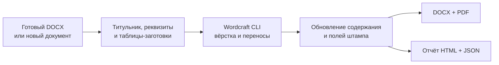

<div align="center">

# 📐 Нормоконтроль ИрГУПС

**DOCX → рамки, штампы и оформление по нормоконтролю → DOCX, PDF и отчёт.**

Локальный помощник для учебных работ: создаёт титульник, содержание и список источников,
собирает шифр работы и проверяет переносы через Wordcraft.


</div>

> **Нужен установленный Wordcraft с `wordcraft-cli`. Microsoft Word и Codex для запуска не нужны.**
> Оформление опирается на положение ИрГУПС П.440300.05.4.092-2017 и образец учебной работы.
> Результат автоматической проверки нужно просмотреть перед сдачей.

---

## Как это работает



- **Рамки для текстовых документов.** На содержании — штамп по рисунку И.3, на следующих листах — И.4.
  Линии 0,75 пт, надписи ISOCPEUR 9 пт; сетка задаётся в миллиметрах, без масштабирования групп.
- **Титульник без ручной сборки.** Студент, группа, преподаватель, регалии, тема, дисциплина,
  вид работы, город и год — необязательные поля. Вуз зафиксирован, факультет и кафедру можно выбрать из списка.
- **Заготовки из образца.** Содержание — таблица из четырёх столбцов, источники — из двух.
  Можно оставить пустыми или сразу ввести строки на соответствующих вкладках.
- **Шифр по реквизитам.** Отдельные правила для учебных работ и ВКР; учётный номер кафедры вводится вручную,
  ведущие нули сохраняются. Полученный шифр попадает в титульник и штамп.
- **Переносы по фактической вёрстке.** Скрипт проверяет страницы таблицы и названия, исправляет отрывы,
  обновляет содержание и повторно открывает сохранённый DOCX для проверки текста и структуры.
- **Работа локально.** Обработка не использует облачные API и не отправляет документ в интернет.
  Исходник остаётся на месте, результат записывается в отдельную папку.

## Быстрый старт

### 1. Зависимости

| Что установить | Для чего |
| :--- | :--- |
| Python 3.11+ с Tkinter | скрипт и окно; в обычной установке Python для Windows Tkinter входит в комплект |
| [Wordcraft](https://github.com/storytold/wordcraft/releases) с `wordcraft-cli.exe` | чтение и запись DOCX, расчёт страниц, экспорт PDF |
| ISOCPEUR Regular и Italic | надписи в штампах; файлы шрифтов в репозиторий не входят |
| PyMuPDF из `requirements.txt` | проверка PDF и обнаружение подстановки шрифта |

Проверено на **Python 3.12, Wordcraft CLI 0.13.2, PyMuPDF 2.0**. Окно Wordcraft заранее открывать не нужно:
программа сама запускает отдельный процесс CLI.

```powershell
git clone https://github.com/k0zt3r/wordcraft-normokontrol.git
cd wordcraft-normokontrol
python -m venv .venv
.\.venv\Scripts\python.exe -m pip install -r requirements.txt
```

Wordcraft устанавливается отдельно, через его установщик. По умолчанию скрипт ищет CLI в `PATH`
и стандартной папке `Program Files\ArtCraft\WordCraft`. Для другого расположения:

```powershell
$env:WORDCRAFT_CLI = "D:\Apps\WordCraft\wordcraft-cli.exe"
```

ISOCPEUR установи в Windows из своего комплекта шрифтов. Если его нет, редактор может подставить другой шрифт:
при установленном PyMuPDF скрипт отметит это в отчёте.

### 2. Запуск кнопкой

Открой **`run.cmd`** или выполни:

```powershell
.\.venv\Scripts\python.exe normokontrol.py
```

1. Выбери DOCX или нажми **Новый документ**.
2. Заполни нужные поля титульника. Пустые поля сохраняют исходные значения; в новом документе личные реквизиты остаются пустыми.
3. При необходимости собери шифр на вкладке **Регистрационный номер** и вставь его в документ.
4. Включи заготовки содержания и источников. Если есть готовые строки, введи их по одной на строку.
5. Нажми **Выполнить нормоконтроль** и просмотри отчёт и PDF.

Для готового DOCX новая папка появится рядом с исходником. Для новой работы окно предложит выбрать место сохранения.

## Командная строка

Обработать готовую работу:

```powershell
python normokontrol.py "работа.docx" --out "outputs\готово"
```

Создать титульник и пустые таблицы:

```powershell
python normokontrol.py --new --out "outputs\шаблон" --toc-template --bibliography-template
```

| Флаг | Что делает |
| :--- | :--- |
| `--no-format` | сохраняет оформление текста; доводит рамки, переносы, содержание и поля |
| `--check-only` | не исправляет оформление и не добавляет элементы; выдаёт отчёт, PDF и копию после чтения/сохранения Wordcraft |
| `--toc-template` / `--bibliography-template` | добавляет пустую таблицу, если её ещё нет |
| `--toc-file FILE` | заголовки содержания из UTF-8 файла, по одному на строку |
| `--bibliography-file FILE` | описания источников из UTF-8 файла, без начальных номеров |
| `--author`, `--group`, `--supervisor`, `--supervisor-title` | данные студента и преподавателя |
| `--work-type`, `--discipline`, `--title`, `--city`, `--year` | реквизиты титульника |
| `--faculty`, `--department`, `--code`, `--stamp-title` | подразделения, шифр и краткое название в штампе |
| `--approval` | добавляет гриф допуска; данные — `--approval-person` и `--approval-title` |
| `--annotation-template`, `--normative-template`, `--abbreviations-template` | заготовки необязательных разделов |
| `--wordcraft PATH` | явный путь к CLI |

Все параметры: `python normokontrol.py --help`.

### Регистрационный номер

По §6.2 код подразделения состоит из **шести цифр**. Длина всего шифра не фиксирована:

| Работа | Пример |
| :--- | :--- |
| Учебная | `КР.420200.10.03.01.ПЗ` |
| ВКР | `ДП.420200.10.03.01.001-2026.ПЗ` |

`001` — пример учётного номера, который выдаёт кафедра. Скрипт не ведёт реестр и не назначает номера автоматически.

```powershell
python normokontrol.py --new --out "outputs\вкр" --generate-code `
  --work-code ДП --division-code 420200 --specialty 10.03.01 --account 001 --year 2026
```

Для года в учебном шифре есть отдельный `--include-year` — только если это требуется кафедральным образцом.
ОН/ОМ используют другую схему; для них согласованный шифр нужно ввести вручную.

## Что получается

```text
работа_нк.docx   редактируемый документ
работа_нк.pdf    PDF из повторно открытого DOCX
report.html     что исправлено и что проверить
report.json     тот же результат для автоматизации
```

Файлы предыдущего запуска не перезаписываются — для повторной обработки укажи новую папку.
Коды завершения CLI: **0** — реализованные проверки без замечаний, **2** — остались замечания, **1** — ошибка.

## Структура

| Файл | Назначение |
| :--- | :--- |
| `normokontrol.py`, `run.cmd` | запуск CLI и окна |
| `scripts/normokontrol.py` | оформление, взаимодействие с Wordcraft, переносы и проверки |
| `scripts/normokontrol_gui.py` | форма с вкладками и необязательными полями |
| `scripts/irgups_data.py` | справочник подразделений и правила номера |
| `scripts/test_normokontrol.py` | интеграционные проверки через настоящий Wordcraft |
| `assets/course-templates.json` | обезличенные титульник и таблицы из образца |
| `Normokontrol.pdf` | положение ИрГУПС, на котором основано оформление |
| `references/document-review.md` | сверка требований и объяснение различий в шифрах |
| `SKILL.md`, `agents/` | необязательный скилл для Codex; для обычного запуска не требуется |

## Проверки

```powershell
.\.venv\Scripts\python.exe -m pip install -r requirements-dev.txt
.\.venv\Scripts\python.exe scripts\test_normokontrol.py
```

Нужны установленный Wordcraft и ISOCPEUR. Тесты создают временные документы и проверяют
шифры на примерах положения, необязательные поля, шаблоны, неизменность исходника, реальные шрифты PDF,
сетку И.3, толщину и соединение линий рамки с точностью 0,001 пт.

## Ограничения и источники

- Автоматическая проверка охватывает оформление. Смысл текста, актуальность источников и полноту разделов проверяет человек.
- Слишком большую таблицу нужно разделить по смыслу. Скрипт не уменьшает шрифт ниже разрешённого ради размещения на листе.
- Используется собственная вёрстка Wordcraft; полное совпадение страниц с Microsoft Word не гарантируется.
- Отслеживаемые исправления нужно принять или отклонить в отдельной копии до обработки. После изменения документа цифровая подпись не сохраняет действительность.
- [Названия факультетов и кафедр](https://www.irgups.ru/org/strukt/univer/ifk/) — снимок официальной структуры головного ИрГУПС от 31.10.2026.
  Коды взяты отдельно из приложения А положения 2017 года. Для новых и переименованных кафедр код не угадывается.
- Формат native JSON и команды Wordcraft могут меняться между версиями. При несовместимом ответе или нарушении проверки текста обработка останавливается.

Исходные работы, результаты обработки, локальные настройки и шрифты исключены из Git. Включён только нормативный PDF
и обезличенный образец; программа не скачивает шрифты автоматически. PDF побайтно совпадает с открытым документом
на официальном сайте ИрГУПС — [источник, SHA-256 и состав шаблонов](references/publication-provenance.md).

## Лицензия

Код — [MIT](LICENSE). Положение `Normokontrol.pdf` — документ ИрГУПС, лицензия на код на него не распространяется.
Шрифт ISOCPEUR принадлежит его правообладателю и в репозиторий не включён.
### Обновление проверки и интерфейса

Поддерживаются Ctrl+C/V/X/A и Ctrl+Z в полях ввода Windows независимо от раскладки, а также меню по правой кнопке. Проверка распознаёт заголовки со служебными символами Wordcraft, содержание в нескольких таблицах с объединёнными ячейками и ссылки на рисунки приложений (например, Б.1–Б.5).

Подробности сверки с положением и границы автоматической проверки: [проверка проекта](references/review-2026-11-01.md). Проверка интерфейса в пользовательской сессии Windows: `python scripts/test_gui.py`.
